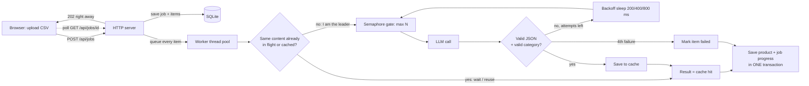

# CatalogIQ - System Design

## Diagram



Same picture in plain text:

```
Browser --POST /api/jobs--> HTTP server --save job+items--> SQLite
   ^                             |  (returns 202 immediately)
   |                             v
   +--poll job progress--   Worker thread pool (20 threads, shared by ALL jobs)
                                 |
                  same content in flight / in cache? --yes--> reuse result (cache hit)
                                 | no
                                 v
                  Semaphore(N)  -> LLM call -> valid? --no--> sleep (backoff) -> try again (max 4 attempts)
                                 | yes                          | 4th failure
                                 v                              v
                           save to cache                  mark product failed
                                 \_______________ ______________/
                                                 v
                          save product + progress (one transaction)
```

## 1. Architecture

**Upload to finished product.** `POST /api/jobs` validates the body, stores the job and every item in SQLite (one transaction), puts each item on a shared thread pool and returns `202` straight away. A worker takes an item, builds its content key (lowercase, collapsed whitespace, SHA-256), and either reuses a cached/in-flight result or calls the LLM with retries. When it finishes, one transaction marks the item done/failed, saves the product and bumps the job counters. The job becomes `completed` in that same transaction when `done == total`. The browser just polls `GET /api/jobs/<id>`.

**What runs in parallel.** Items. Up to 20 worker threads pick items at the same time, across all jobs.

**How the limit is enforced.** There is exactly one `threading.Semaphore(LLM_CONCURRENCY)` and exactly one function, `call_llm_once()`, that talks to the LLM. It takes the semaphore before the call and releases it after. Because there is one semaphore for the whole process, the limit holds across all jobs. The "calls in progress" counter and its maximum are updated inside the semaphore, so the metric can never exceed N. The retry *sleep* happens outside the semaphore, so a waiting item does not block a slot.

**Why threads.** LLM calls are network waits, so threads are enough (the GIL is released while waiting). Threads share memory, so the semaphore, metrics and in-flight table are plain Python objects. The standard-library `sqlite3` module and `http.server` are blocking, so threads fit them naturally, and the code stays easy to read.

**Rejected alternatives.**
- *asyncio*: also fine for I/O, but needs an async SQLite library and `async/await` everywhere. More concepts, no real gain at this size.
- *multiprocessing*: separate memory means the semaphore, metrics and in-flight table would need IPC (Manager/Redis). Heavier and harder to defend, and we are not CPU-bound.
- *One pool per job*: would break "limit across all jobs".
- *Celery/Redis*: right for production, too much setup for this assignment.
- *`sleep()` to slow down*: does not cap concurrency, only rate.

**No repeated work.** `get_result()` takes a lock and checks, in this order: (1) is this content already in flight? then wait on its event; (2) is it in the DB cache? then reuse; (3) otherwise register as the *leader* and call the LLM. The leader saves to the cache **before** removing itself from the in-flight table, so there is no gap where a duplicate could slip through. If the leader fails after 4 attempts, the waiters get the same error.

## 2. Crash recovery

Jobs and items live in SQLite from the moment the request is accepted, so nothing is lost with the process. Each item has a state (`pending`, `done`, `failed`), and "mark item done + save product + update job counters" is one transaction, so a crash can never leave those three out of sync.

If the server dies halfway through a 10,000-item job: on start-up `start_unfinished_jobs()` finds items that are still `pending` in jobs that are not `completed` and puts them back on the queue. Finished items are never redone. Items that were being processed at the moment of the crash are still `pending`, so they run again; the LLM cost of that is at most a few calls, and anything already in `enrichment_cache` costs nothing. I tested this by killing the process with `kill -9` in the middle of the 210-item sample job: 80 items were done, 130 resumed, and the job finished at 210/210.

What I would add for a bigger system: a `processing` state with a lease time (so several servers can claim rows safely with `UPDATE ... WHERE state='pending' LIMIT n`), and reading the queue from the database in batches instead of queuing 10,000 items in memory.

## 3. Scale and cost (1 million listings a day)

1M/day is about 12 listings/second on average, more at peak. One request per listing is too many for a limited requests-per-minute quota, so I would reduce the number of calls first, then control the rest:

1. **Cache and dedupe first** (already built). Sellers repeat titles a lot; every hit costs nothing. Include the prompt version in the cache key so a prompt change does not reuse old answers.
2. **Batch 10-20 products per prompt** and ask for a JSON array. This cuts requests 10-20x (roughly 50-100k calls a day) and also saves repeated instruction tokens. Validate each item separately; re-send only the bad ones alone.
3. **Cheap rules before the LLM**: obvious cases (known brand + clear keyword) can be handled without a call.
4. **A shared rate limiter** (token bucket in Redis) in front of every worker, so many machines together stay under the provider's requests-per-minute and tokens-per-minute. On HTTP 429 obey `Retry-After` instead of blind retries.
5. **Several workers/machines** reading from a durable queue (Redis/SQS/RabbitMQ or the DB with row claims), each with a local semaphore plus the shared limiter.
6. **Second provider as fallback** behind a circuit breaker: after repeated errors or 429s, route traffic to the backup, and record which provider produced each result.
7. Use a small, cheap model by default; escalate only the low-confidence items to a stronger one.

## 4. API performance (5 million products)

`GET /api/products?q=...` is slow because `LIKE '%text%'` cannot use a normal index, so SQLite scans every row (twice: once for `COUNT(*)`, once for the page). `OFFSET 100000` also has to walk past 100,000 rows before returning anything, and `LOWER()` on the column defeats an index too.

Fixes, in order of value:
- **Full-text search**: SQLite FTS5 (or Postgres `tsvector`/trigram GIN, or OpenSearch) over title and clean title. Search becomes an index lookup.
- **Composite index** `(category, sku)` so category filter + `ORDER BY sku` is answered from the index.
- **Cursor (keyset) pagination**: `WHERE sku > :last_sku ORDER BY sku LIMIT 20` stays fast on page 50,000. The trade-off is that you lose "jump to page N", and the assignment's contract uses `page`/`total`, so this project keeps offset pagination.
- **Avoid exact `COUNT(*)`** on huge sets: cache it, or return an approximate count / "has more".
- **Cache** hot queries (first page, popular categories) for a few seconds in memory or Redis; add read replicas if traffic is high.

## 5. Quality (invented brands, wrong categories)

Catch it automatically with cheap checks, then send only risky items to a human:
- **Brand not in the text**: if the brand the LLM returned does not appear in the raw title/description (fuzzy match) and is not in a known-brand list, flag it as a likely invention.
- **Category disagreement**: compare with a simple keyword rule or a small classifier; if they disagree, or the category is `Other`, flag it.
- **Shape checks** (already done): valid JSON, category from the list, tags limited to 5 lowercase. Items that needed retries are less trustworthy.
- **Title drift**: clean title very different from the raw title (low word overlap) is suspicious.
- **Second opinion**: for a sample or for flagged items, ask a second model or ask the same model twice; disagreement means review.

Turn these into a **risk score** and show the review queue highest score first (plus a random 1-2% sample of "good" items to measure the real error rate). Every human edit (`PATCH`) is a labelled example: use it to measure accuracy, add few-shot examples to the prompt, and grow the known-brand list.
